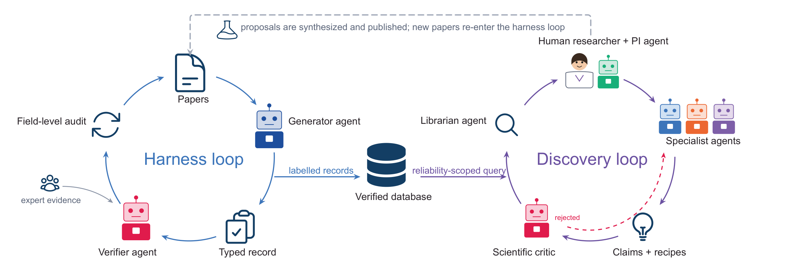
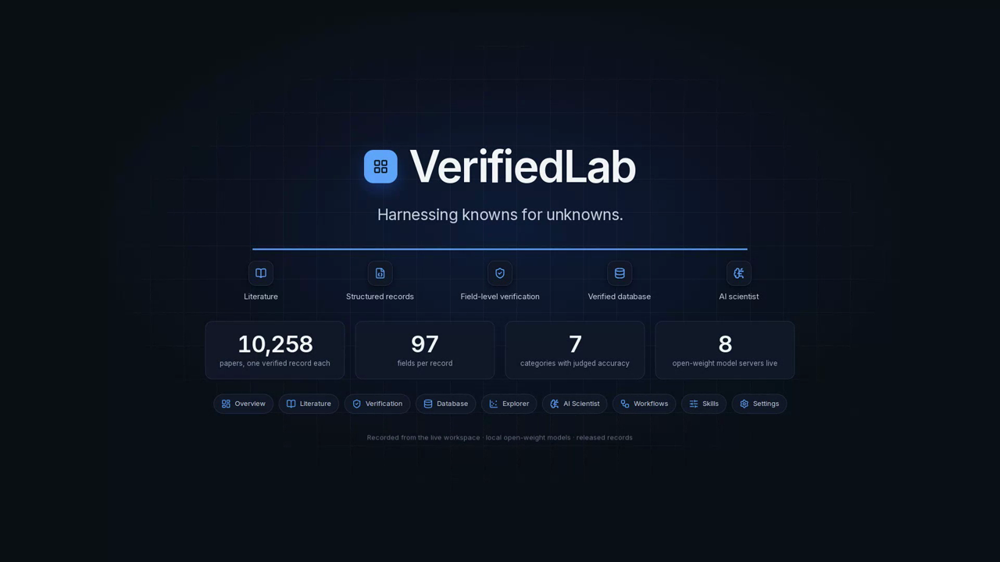

## VerifiedLab: Harnessing Knowns for Unknowns

### [Paper](https://arxiv.org/abs/2610.37923) | [Dataset](https://huggingface.co/datasets/jiayijdong/VerifiedLab) | [Demo](https://youtu.be/9TP1gdmzB4I)

Yu Yao, Jiayi Dong, Yang Yang, Shuiwang Ji, Ju Li

This is the implementation of the paper "VerifiedLab: Harnessing Knowns for Unknowns". VerifiedLab is a harness that carries the experimental literature to AI scientists. A generator agent writes one typed record per paper and a verifier agent checks it field by field, both under written, versioned scientific policies (*Skills*). On top of the verified records, a team of AI scientists works with a human researcher: a PI agent plans, a librarian computes evidence from the records, specialist agents draft claims, and a reliability gate and a scientific critic check every claim against its evidence.

<p align="center"></p>

A two-minute demo of the research workspace, recorded with the agents running on local open-weight models:

<p align="center"><a href="https://youtu.be/9TP1gdmzB4I"></a></p>

## Code

The code may be found in the following subfolders

* `./verifiedlab/` contains the harness and the multi-agent framework
  * `policies/` the annotation and verification Skills and the workflow policy (reliability gate)
  * `verifiedlab/agents.py` generator, verifiers, PI, specialist team and critic
  * `verifiedlab/rules.py` the part of the verification Skill that runs as code (ordered layer stacks, unit-aware numeric tolerance, architecture aliases)
  * `verifiedlab/librarian.py` evidence tools over the verified records
  * `verifiedlab/gate.py` reliability gate and the harness verdict
  * `verifiedlab/research.py` one research session: PI → librarian → specialists → gate → critic
  * `verifiedlab/orchestrator.py` the full harness run: draft → verify → repair → query → audit → gate → critique
  * `ui/`, `server.py`, `explore.py`, `cli.py` the research workspace (web and terminal)
  * `slurm/` model servers (vLLM) for the agent roles
* `./discovery/` and `./scripts/` contain the device-performance prediction models (tabular, fine-tuned text encoders and LLMs) on the verified records

The verified device records can be downloaded from [Hugging Face](https://huggingface.co/datasets/jiayijdong/VerifiedLab).

If you would like to cite the paper, here is a bibtex file:

```bibtex
@article{yao2026verifiedlab,
  title={VerifiedLab: Harnessing Knowns for Unknowns},
  author={Yao, Yu and Dong, Jiayi and Yang, Yang and Ji, Shuiwang and Li, Ju},
  journal={arXiv preprint arXiv:2610.37923},
  year={2026}
}
```

MIT License. Icons in the workspace are Lucide (ISC).
